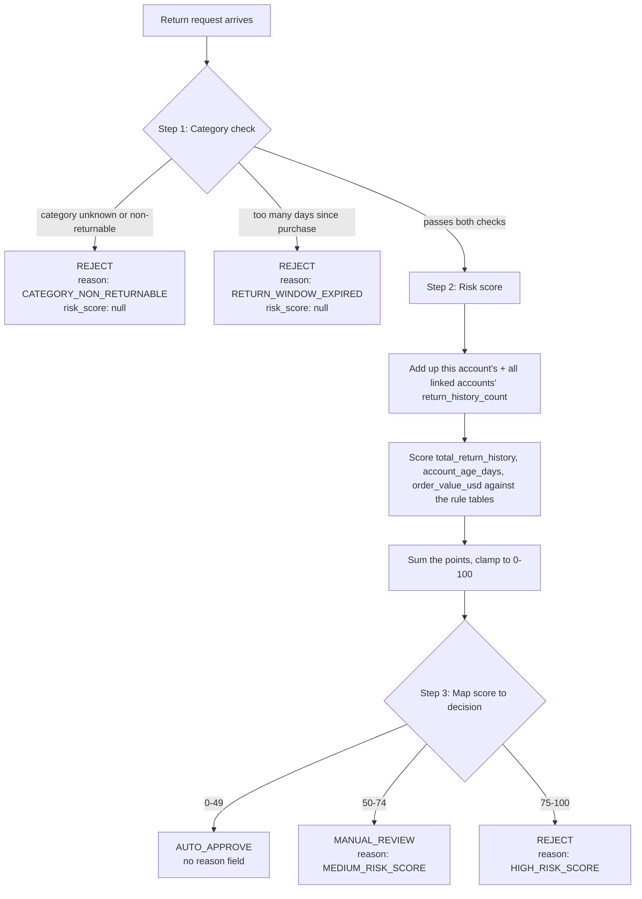

# The Big Picture: What Is This Program Actually For?

Before looking at a single line of C++, you should be able to explain what this program does to a non-technical person. If you can't, no amount of code-reading will feel like it "clicks" — you'll be memorizing syntax instead of understanding a decision process. So: forget the code for five minutes.

## The scenario

Imagine you work in Amazon's returns department, but instead of a human reviewing every return request, a piece of software does the first pass. For every "I want to return this item" request that comes in, the software has to answer three questions, in order:

1. **Is this item even allowed to be returned, and is it still within the return window?**
   If the category doesn't allow returns at all (groceries, software licenses), or the customer waited too long, the answer is an immediate **no** — don't bother going further.

2. **If it's allowed, how risky is this return?**
   Some customers return things constantly, some don't. Some customers share a shipping address, payment method, or device with other accounts that abuse returns — Amazon treats those as one connected cluster of risk, not separate strangers. The software adds up signals (return history, account age, order value) into a single risk score.

3. **What do we do with that score?**
   Low risk → auto-approve, no human needed. Medium risk → send to a human for manual review. High risk → reject outright.

That's the entire program. Everything in the codebase exists to answer those three questions for a big list of return requests, one at a time, and write the answers to a file.

## Why "linked accounts" exist as a concept

This is the part that trips people up first, so it's worth sitting with. Return-abuse rings don't use one account each — someone might make five accounts to get five free returns instead of one. But those five accounts usually share *something* physical: the same shipping address, the same credit card, the same device. The `account_links.jsonl` file is a list of those shared-signal relationships between pairs of accounts.

The program's job here is: given a customer's account, find every other account connected to it (possibly through a chain — A shares a device with B, B shares a payment method with C, so A, B, and C are all one cluster even though A and C never directly shared anything), and add up *all* of their return histories, not just this one account's. A customer with a spotless personal history who's quietly clustered with four serial-returners should not look "clean" to the system.

## The three-step pipeline, visually



Keep this diagram in your head. Every function you'll read about in [[07-Walkthrough-Engine]] is just one box in this picture.

## Restating the spec cleanly

Your [README.md](../README.md) is the actual assessment brief, and it has its own typos and rough formatting (e.g. it says "return_history_count as O" meaning the digit `0`, and "MEDIUN_RISK_SCORE" meaning `MEDIUM_RISK_SCORE`, and one example JSON block is malformed). That's the source document, not something you need to fix — just don't let its typos confuse you. Here is the same spec, restated cleanly.

### Input: one return request looks like this

```json
{"request_id": "r101", "account_id": "u001", "category": "ELECTRONICS", "days_since_purchase": 12, "order_value_usd": 250, "account_age_days": 400}
```

- `order_value_usd` and `account_age_days` are described as optional — a request is allowed to omit them.

### Step 1 — Category checks (in this order)

1. Look up `category` in `data/category_rules.json`.
   - Not found, **or** found but `"returnable": false` → **REJECT**, reason `CATEGORY_NON_RETURNABLE`, `risk_score: null`. Stop here.
2. Compare `days_since_purchase` to that category's `allowed_return_window_days`.
   - If `days_since_purchase > allowed_return_window_days` → **REJECT**, reason `RETURN_WINDOW_EXPIRED`, `risk_score: null`. Stop here.
3. Otherwise, continue to Step 2.

### Step 2 — Risk score

**2a. Aggregate return history.** Starting from the request's `account_id`:
- Take its own `return_history_count` from `data/account_profiles.jsonl` (missing profile → treat as `0`).
- Find every account transitively linked to it via `data/account_links.jsonl` (A→B and B→C means A, B, and C are all one group — see the worked example below) and add each of *their* `return_history_count` values too.
- Call the sum `total_return_history`.

**2b. Score three attributes independently**, using `data/scoring_rules.json`. For each rule (`total_return_history`, `account_age_days`, `order_value_usd`), find which `[min, max]` bracket the value falls into, and take that bracket's `points`.

**2c. Sum the three point values, then clamp the total into the range 0-100.** That final number is `risk_score`.

### Step 3 — Decision + reason

Using `data/decision_bands.json`:

| risk_score | decision | reason |
|---|---|---|
| 0-49 | `AUTO_APPROVE` | *(omitted entirely)* |
| 50-74 | `MANUAL_REVIEW` | `MEDIUM_RISK_SCORE` |
| 75-100 | `REJECT` | `HIGH_RISK_SCORE` |

Note that `decision_bands.json` only stores `min_score`/`max_score`/`decision` — **the reason text is not data, it has to be decided in code** based on which band matched. Keep that in mind; it's directly relevant to one of the 8 bugs.

## A worked example, by hand, before you see any code

Take request `r101`: account `u001`, category `ELECTRONICS`, 12 days since purchase, $250 order, account age 400 days.

- **Step 1:** `ELECTRONICS` is returnable with a 30-day window. `12 ≤ 30` → passes both checks.
- **Step 2a:** Looking at `data/account_links.jsonl`, `u001` is linked to `u002`, which is linked to `u003`, which is linked to `u004`, which is linked to `u005` — one connected chain of 5 accounts. Their `return_history_count` values (from `data/account_profiles.jsonl`) are `u001=2, u002=0, u003=0, u004=2, u005=1`. Sum = **5**.
- **Step 2b:** `total_return_history=5` → the "3-5" bracket → 15 points. `account_age_days=400` → the "180+" bracket → 0 points. `order_value_usd=250` → the "200-499" bracket → 10 points.
- **Step 2c:** `15 + 0 + 10 = 25`. Already within 0-100, no clamping needed.
- **Step 3:** `25` falls in `0-49` → **AUTO_APPROVE**, no reason.

Hold onto this number (**25, AUTO_APPROVE**). In [[09-End-to-End-Trace]] you'll see what the *actual buggy program* produces for this exact request, and it is not 25. The gap between "25, AUTO_APPROVE" (correct) and whatever the buggy code outputs is, itself, evidence of which bugs are active — that comparison technique is one of the most useful debugging skills in this whole exercise.

Next: [[02-Cpp-Concepts-You-Need]]
